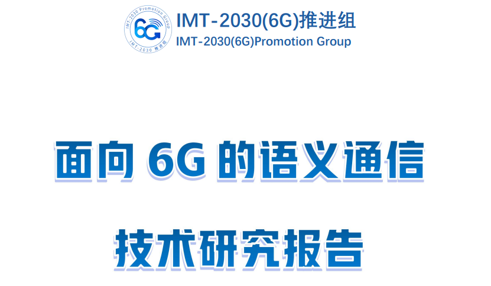
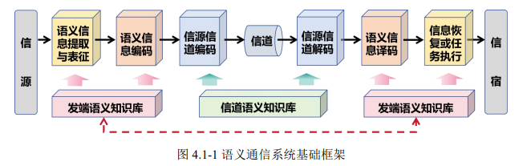
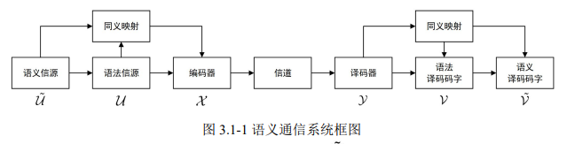
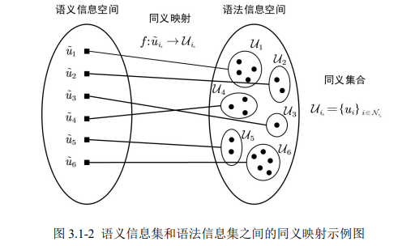
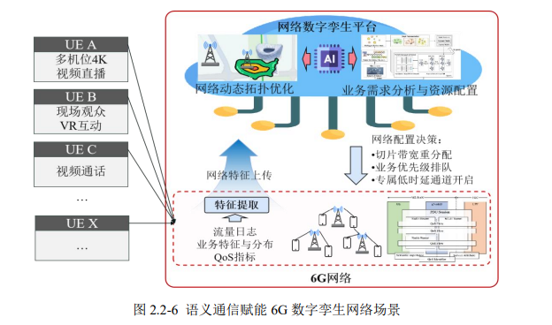
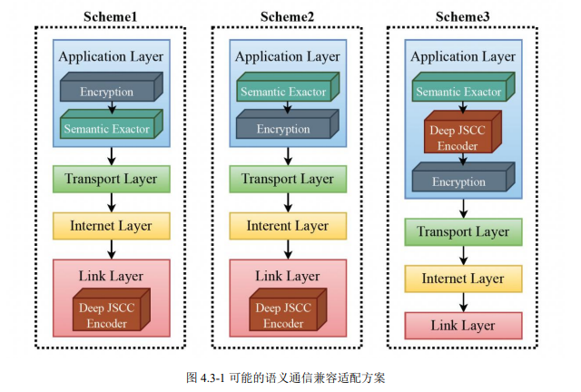
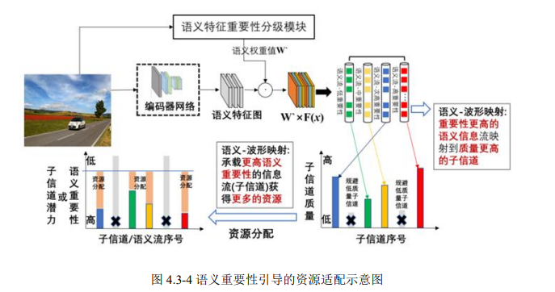
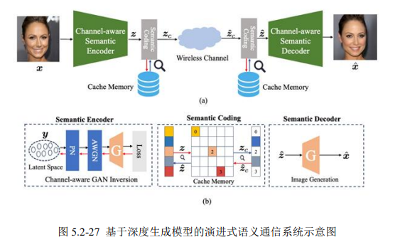

# 6G Core Technology Forecast: Semantic Communication, Making the Network "Understand" Your Needs!

6G Core Technology Forecast: Semantic Communication, Making the Network "Understand" Your Needs!
From voice calls in the 1G era to high-speed connectivity in the 5G era, communication technology has always evolved around "efficient transmission of bits." However, as we approach the 6G era, the emergence of immersive communication, intelligent body interactions, and integrated air, ground, and space scenarios pose challenges to traditional "bit-driven" communication models. We no longer need simple signal transmission; instead, we require an intelligent communication paradigm that can precisely understand information meanings and efficiently match task requirements.
Semantic communication, as one of the key potential technologies for 6G, is stirring a communication revolution: it breaks away from the limitations of traditional symbolic level transmission, upgrading communication from "delivering accurately" to "understanding correctly," offering a new possibility for future intelligent interconnectivity.
What is Semantic Communication? Traditional communication follows Shannon's information theory, focusing on accurate symbolic transmission without concern for the actual meaning of information—like transmitting a book word by word, even if there are misspellings or omissions, ensuring completeness regardless of whether the reader can understand the core idea.
The core of Semantic Communication is "centered on meaning": through artificial intelligence technology, it deeply mines data's semantic features, extracts key information, and transmits it. The receiving end does not need to restore all original data but only accurately understand its meaning and meet task requirements. For example, in emergency rescue scenarios, drone footage of disaster areas can be automatically extracted with critical semantic information such as "collapsed buildings" and "rescued individuals," prioritizing core content transmission, significantly improving rescue decision efficiency.
Technically speaking, Semantic Communication is based on AI and information theory, constructing an end-to-end architecture of "semantic extraction-encoding transmission-semantic restoration," achieving a leap from "symbolic transmission" to "semantic understanding," laying the foundation for 6G's transition from "connectivity" to "understanding, self-evolving."
Semantic Communication's typical application scenarios fully highlight its value in key 6G scenarios: from emergency support to daily experiences, it is evident everywhere:
1. Low Signal-to-Noise Ratio and Lossy Transmission Scenarios: Reliable communication in extreme environments relies on the communication link formed by drones and satellites, which can prioritize critical disaster information transmission under low bandwidth and high interference conditions through semantic communication. This enables emergency centers to quickly acquire core data such as the distribution of affected areas and the locations of trapped individuals, supporting precise rescue operations.
In the scenario of drone inspections at low altitudes, multimodal data collected by drones, such as power lines and pipelines, do not require full retransmission. Instead, through semantic feature extraction, only key information like "structural anomalies" or "leak points" is transmitted, reducing network load while ensuring reliability under complex channel conditions.
2. Enhanced Business Experience Scenarios: Ultimate Guarantee for Immersive Services
For XR (Extended Reality) and Holographic Communications applications, semantic communication ensures dynamic resource allocation through a "understand first, then transmit" logic. For instance, when using AR glasses in a high-speed rail tunnel for live broadcasting, the system prioritizes crucial features of the video, compressing redundant background information, thus maintaining a smooth experience even in low bandwidth environments.
In virtual reality scenarios like the metaverse, semantic communication solves the issue of low latency. By intelligently encoding and prioritizing semantic information such as virtual scenes and user actions, it achieves end-to-end latency below 20 milliseconds, significantly reducing motion sickness and making virtual social interactions and virtual try-on experiences more natural.
3. Enhanced Human-Machine-Object Interaction Scenarios: Core Bond of Intelligent Connectivity
In the field of autonomous driving, multi-vehicle collaborative perception relies on real-time information exchange between vehicles. Semantic communication transforms vehicle sensor data into higher-level semantic information like "obstacle category" and "motion state", only transmitting decision-critical data. This not only reduces transmission delay but also enhances environmental modeling accuracy, safeguarding safe driving.
In the industrial internet, semantic communication empowers AGV carts, robotic arms, and other intelligent devices to achieve efficient collaboration: Devices do not need to transmit massive raw sensor data; instead, they exchange core semantics such as "task instructions" and "location information," enabling on-demand configuration of production resources and efficient scheduling, pushing factories towards unmanned and intelligent upgrades.
4. In intra-network data compression scenarios: Efficient use of network resources in 6G networks generates massive data due to digital twins, multi-service concurrency, etc. Semantic communication precisely extracts and compresses deep features of intra-network data, accurately distilling core semantics related to network status and business needs, significantly reducing transmission load and latency. For example, in large stadium concert scenes, dynamic optimization of resource allocation for multi-services like 4K live broadcasting and VR interactions can be ensured, ensuring all users have a high-quality experience.
III. Core breakthroughs in semantic communication technology:
1. Fundamental theory innovation: Building a mathematical framework for semantic communication. Semantic Information Theory is the theoretical cornerstone of semantic communication, establishing connections between syntactic information (such as text and image symbols) and semantic information (such as meaning and intent) through "synonym mapping." It defines key metrics such as semantic entropy and semantic channel capacity, proving the efficiency advantage of semantic communication over traditional communication from a mathematical perspective.
The introduction of the Information Transmission Rate (ITR) metric provides a unified standard for performance comparison across different communication schemes, considering both transmission speed and semantic distortion, making the performance evaluation of semantic communication more scientific and comprehensive.
2. System design optimization: Compatibility with existing networks' intelligent architecture. Semantic communication is not a revolution over existing communication systems but a deep integration and upgrade. Through designs like an encryption-compatible semantic communication compatible framework and MAC-PHY cross-layer adaptation, semantic communication can seamlessly integrate with the existing TCP/IP protocol architecture while achieving semantic-level optimization.
In terms of evaluation systems, Semantic Communication has established multi-dimensional indicators: these include not only transmission efficiency metrics such as semantic adaptation and spectral efficiency but also semantic restoration metrics like PSNR (Peak Signal-to-Noise Ratio) and BLEU scores for different modal data. It also supports task-driven metrics such as classification accuracy and retrieval recall rate, comprehensively measuring the level of "comprehensibility".
3. Key Technologies Breakthrough: AI-Powered High-Efficiency Transmission ★
Joint Source-Channel Coding (JSCC): By breaking away from the traditional separation of source coding and channel coding, this approach utilizes AI models to jointly optimize encoding and channel characteristics, maintaining high semantic fidelity even in low signal-to-noise ratio environments.
★
Modulation Division Multiple Access (MDMA): Innovative introduction of "semantic domain" as a resource allocation dimension allows for the overlaid transmission of semantic signals by different users on the same time-frequency resources, significantly enhancing the spectral efficiency in multi-user scenarios.
★
Semantic Knowledge Base: As the "brain" of Semantic Communication, it integrates multimodal background knowledge to assist with semantic extraction, encoding, and restoration, enabling the system to accurately understand information meaning under complex scenarios.
★
AI Model Collaboration: The application of advanced AI technologies such as Transformer, Mamba, and diffusion models has made semantic feature extraction more precise, encoding more efficient, and restoration more robust, driving Semantic Communication towards lightweight and high-performance development.
4. From Theory to Practice: Experimental Verification of Semantic Communication Currently, Semantic Communication has moved from theoretical research to experimental verification. The Semantic Communication Simulation Platform developed by Pengcheng Laboratory supports end-to-end transmission verification of multimodal data, achieving a deep integration of semantic protocol stack and high-fidelity channel simulation, significantly improving simulation efficiency compared to traditional solutions.
In the prototyping verification system, the performance advantages of semantic communication are fully demonstrated: in air interface function verification, the semantic communication scheme can maintain stable transmission quality under different signal-to-noise ratio conditions, avoiding the "cliff effect" of traditional communication; in modulation division multiple access technology verification, multi-user semantic signals can still be transmitted with high semantic similarity; in image/video transmission experiments, even in low signal-to-noise ratio environments, semantic communication can still reconstruct clear key content, significantly outperforming traditional compression transmission schemes.
V. What will Semantic Communication Change in the 6G Era? The emergence of semantic communication is not only a technological upgrade but also a restructuring of the intelligent interconnected ecosystem:
★  
For individual users: Immersive experiences will be smoother, remote interactions more natural, and applications such as VR/AR and the metaverse will truly enter daily life.
★  
Industry field: Industrial production becomes more intelligent, emergency rescue is more efficient, and intelligent transportation is safer. It injects new momentum into the digital transformation of various industries.
★  
For the network itself: The network shifts from "passive transmission" to "active understanding", capable of dynamically allocating resources and self-optimizing scheduling based on semantic importance, achieving more efficient and reliable intelligent operation and maintenance.
From "transmitting bits" to "transmitting meanings", semantic communication is reshaping the essence of communication. With the continuous deepening of research on 6G, semantic communication will develop in tandem with technologies such as wireless AI and perceptive communication, constructing an intelligent communication network that can "understand, think, and evolve".
The future has arrived. When the internet is no longer merely a "transporter" of signals, but a "partner" that can precisely understand needs, an unprecedented array of intelligent applications will emerge. Let us look forward to the new changes brought about by 6G semantic communication!
If you want to know more about 6G technology details, please leave a comment in the comments section to discuss. We will continue to bring you cutting-edge technology interpretations.

## Images

<!-- PAYMENT_BLOCK -->

## Get this dataset

- Payment link (Stripe): [Buy now](https://buy.stripe.com/3cs8yP7sY87d0vu9AB)
- Payment QR code: 

<!-- /PAYMENT_BLOCK -->
